# dexdata v1 데이터 통계 (2026-10-12)

`data/v1` (100.0M transition, 409,009 episode)의 분포를 정책별로 정리했다. 그림과 숫자는 아래 명령으로 다시 만든다 (CPU만 사용, 약 30초).

```
~/env_isaaclab6/bin/python scripts/dataset_stats.py data/v1
```

- **episode 단위 통계**(길이, 종료 원인, DR 물성)는 모든 episode를 썼다.
- **step 단위 통계**(관절, keypoint, 물체)는 정책마다 무작위 episode를 통째로 골라 약 1.5M 행씩 썼다 (seed 0). episode를 통째로 쓰므로 속도와 4-step 변위가 episode 경계를 넘지 않는다.
- 모든 숫자는 [`figures/dataset_stats/stats.json`](figures/dataset_stats/stats.json)에 있다.
- 색은 모든 그림에서 같다. 파랑 `nut_goal_normal`, 주황 `nut_goal_slow15`, 초록 `nutbolt_student_scale`.

## 요약

| 정책 | task | 행 | episode | 평균 길이 | 종료 원인 (episode %) | 종료 원인 (행 %) | fingertip 평균 속도 | 0.2 s 변위 중앙값 / p95 |
|---|---|---|---|---|---|---|---|---|
| `nut_goal_normal` | NutGoalEnv (자유 너트 목표 회전) | 40.0M | 169,736 | 236 step (11.8 s) | timeout 39 / drop 61 | timeout 67 / drop 33 | 6.2 cm/s | 5.8 / 17.4 mm |
| `nut_goal_slow15` | NutGoalEnv (slow 스타일) | 20.0M | 96,158 | 208 step (10.4 s) | timeout 30 / drop 70 | timeout 58 / drop 42 | 4.0 cm/s | 2.7 / 15.7 mm |
| `nutbolt_student_scale` | nutbolt_trinut (볼트 위 너트 돌리기) | 40.0M | 143,115 | 280 step (14.0 s) | timeout 22 / stagnation 78 | timeout 63 / stagnation 37 | 3.5 cm/s | 1.3 / 20.8 mm |

- 제어 주기는 모두 20 Hz (`step_dt` 0.05 s)다. timeout은 dexgen 400 step (20 s), dexscrew 800 step (40 s)이다.
- `success`/`success_event`는 세 정책 모두 항상 False다. 수집기가 이 값을 채우지 않는다. 과제 진행은 `goal_reached_event`(dexgen)와 `object_dof_pos`(dexscrew)로 본다 (11절).
- 저장된 episode 기준으로 남긴 행 비율은 90% / 88% / 99.6%다. dexgen은 drop으로 끝난 episode의 마지막 2초를 잘랐다. [수집 가이드 7절](collection_guide.md)의 87% / 84%는 너무 짧아져 통째로 버린 episode까지 분모에 넣은 값으로 보인다.

## 1. episode 길이

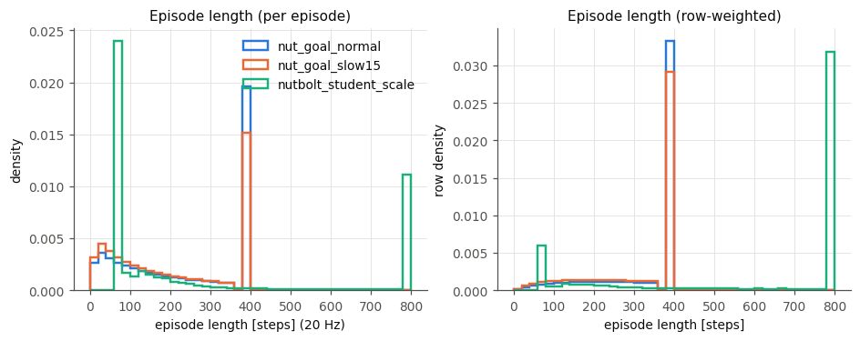

- dexgen은 400 step(timeout)에 봉우리가 있고, 나머지는 0–380 step에 고르게 퍼진 drop episode다. drop episode는 마지막 40 step이 잘려 있다.
- dexscrew는 길이가 둘로 갈린다. 약 70–100 step(3.5–5 s)에 끝나는 stagnation episode가 episode 수로는 대부분이고, 800 step timeout episode가 행 수로는 대부분이다 (오른쪽, 행 가중).

## 2. 종료 원인

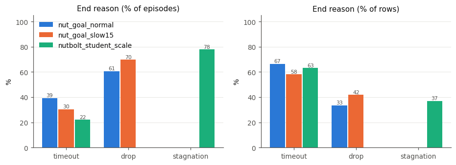

- dexgen은 drop과 timeout뿐이다. slow 정책이 drop 비율이 더 높다 (61% → 70%).
- dexscrew는 drop이 없다. 넛이 볼트에 끼워져 있어서 떨어질 수 없고, 넛이 멈추면 stagnation으로 끝난다.

## 3. Domain randomization 범위

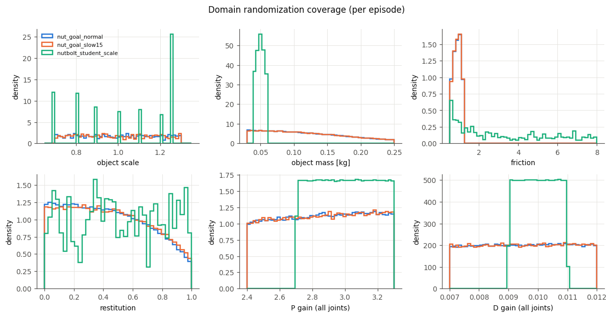

- **크기:** dexgen은 0.7–1.3 연속 균등 분포다. dexscrew는 {0.7, 0.8, 0.9, 1.0, 1.1, 1.2, 1.25} 7개 값이다. dexscrew는 크기마다 행이 14.3%씩 고르게 나뉘고, 1.25의 episode가 짧아서 episode 수로는 1.25가 32%다.
- **질량과 마찰:** dexgen 질량은 0.03–0.25 kg, 마찰은 0.5–1.2다. dexscrew 질량은 0.04–0.06 kg으로 좁고, 마찰은 0.5–8로 넓다.
- **PD gain:** dexgen은 P 2.4–3.3, D 0.007–0.012다. dexscrew는 P 2.7–3.3, D 0.009–0.011로 더 좁다.
- restitution은 env마다 고정이다 (1024개 값). 그래서 dexscrew 히스토그램이 들쭉날쭉하다.

## 4. 크기별 결과

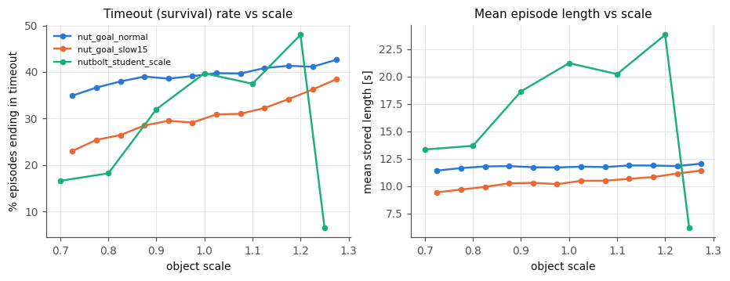

- dexgen은 크기가 클수록 timeout 비율이 조금 오른다 (normal 35% → 43%, slow 23% → 39%). 평균 길이는 크기와 거의 관계없다.
- dexscrew는 1.25에서 성능이 급격히 떨어진다. timeout 6.5%, 평균 길이 6.2 s다 (1.2에서는 48%, 23.8 s). 0.7–0.8도 timeout이 17–18%로 낮다.

## 5. 관절 위치

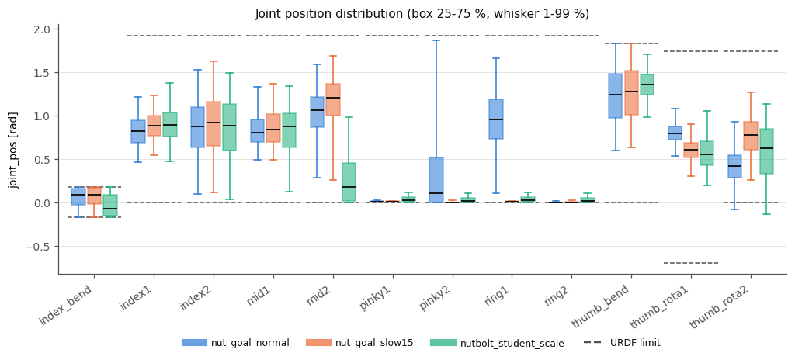

- `nut_goal_normal`만 ring1과 pinky2를 크게 움직인다 (1–99% 범위가 URDF 범위의 81%, 97%). slow와 dexscrew는 ring/pinky를 거의 0에 고정한다.
- dexscrew는 mid2를 덜 굽히고 thumb_bend를 더 굽힌다. index_bend는 세 정책 모두 양쪽 한계까지 쓴다.
- dexscrew thumb_rota2의 하위 1%는 URDF 하한 0보다 낮다 (−0.13 rad). dexscrew env가 쓰는 관절 한계가 URDF와 다를 수 있다.

## 6. 관절 속도, 제어 오차, target 변화량

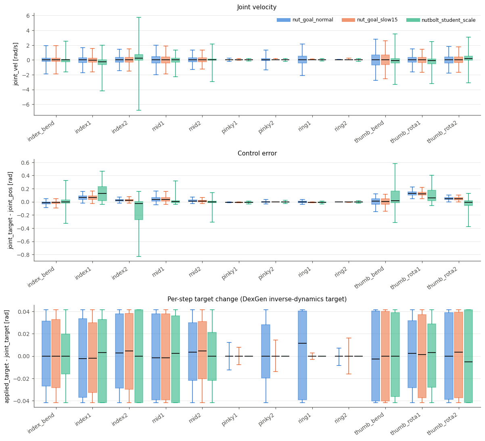

- `applied_target - joint_target`(DexGen inverse-dynamics의 출력)은 ±0.0417 rad (= 1/24)에서 잘린다. 이 한계에 걸린 값의 비율은 normal 23%, slow 18%, dexscrew 31%다.
- dexscrew는 index1/index2/thumb에서 제어 오차가 크다 (|오차| p95 0.31 rad, dexgen은 0.13 rad). 손가락이 넛이나 볼트에 막혀 target에 닿지 못하는 경우가 많다.

## 7. fingertip 작업 공간 (손목 좌표계)

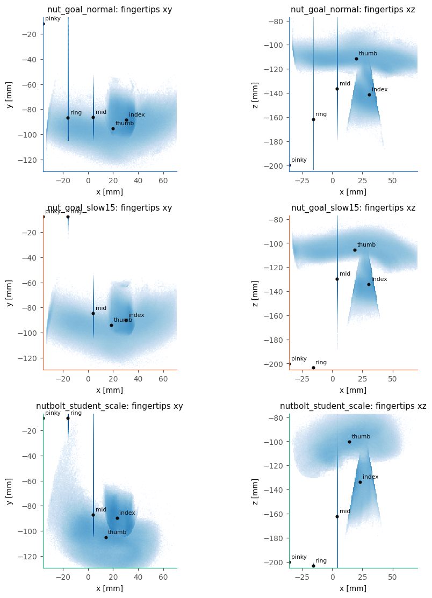

- 5개 fingertip(`tips` 집합)을 합쳐 그린 log 밀도다. 검은 점은 손가락별 중앙값이다.
- slow와 dexscrew는 ring/pinky 끝이 펴진 자세(y ≈ −10 mm, z ≈ −200 mm) 한 점에 몰려 있다. normal은 ring 끝이 손바닥 쪽(z ≈ −160 mm)으로 들어와 있다.
- 세로로 긴 선은 굽혔다 펴는 손가락의 궤적이다. 이 손가락은 x가 거의 일정한 y–z 평면에서만 움직인다.

## 8. fingertip 움직임

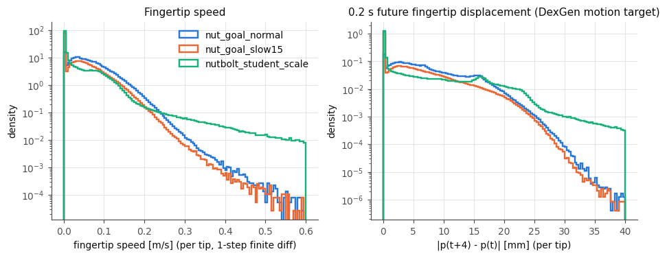

- fingertip 속도 중앙값은 normal 5.4 cm/s, slow 2.8 cm/s, dexscrew 0.6 cm/s다. 0에 있는 봉우리는 멈춰 있는 ring/pinky다. 이 두 손가락이 5 mm/s 미만으로 움직이는 행은 slow와 dexscrew에서 92–94%, normal에서는 ring 3%, pinky 33%다.
- dexscrew는 대부분 멈춰 있다가 가끔 빠르게 움직인다. 0.2 s 변위 중앙값은 1.3 mm로 가장 작지만, 꼬리는 가장 길다 (p95 20.8 mm). dexgen의 0.2 s 변위는 25 mm 위에서 지수적으로 줄어든다.

## 9. 물체

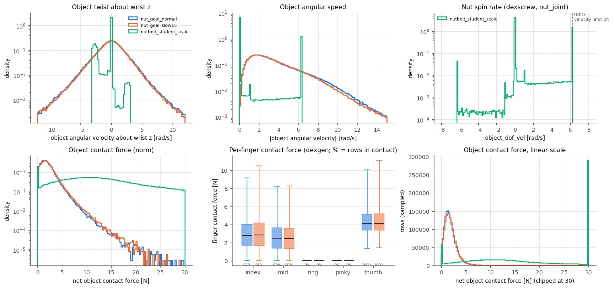

- **dexgen 너트 회전:** 손목 z축 둘레 각속도는 0을 중심으로 대칭이고, |ω| 중앙값은 2.9 rad/s다. normal과 slow의 물체 회전은 거의 같다. 둘의 차이는 손가락 움직임에서 난다 (8절).
- **dexscrew 너트 회전:** `object_dof_vel`은 0 근처(84%)와 URDF `nut_joint`의 속도 한계 2π rad/s(12%)에 몰려 있다. 넛이 돌 때는 대부분 속도 한계에서 돈다. |ω| 그래프의 6.28 봉우리도 같은 원인이다.
- **접촉력:** dexgen은 중앙값 1.7 N이다. 물체를 쥐는 손가락은 thumb(100%), index(92%), mid(91%)이고, ring/pinky는 물체에 닿지 않는다. dexscrew의 `object_contact_force`는 볼트와의 접촉을 포함한다. 중앙값은 14 N이지만 30 N을 넘는 행이 22%이고, 최대 10^6 N대의 값도 있다. 손의 힘으로 해석하면 안 된다. dexscrew에는 `finger_contact_force`가 없다 (NaN).

## 10. 관절 공간 coverage (PCA)

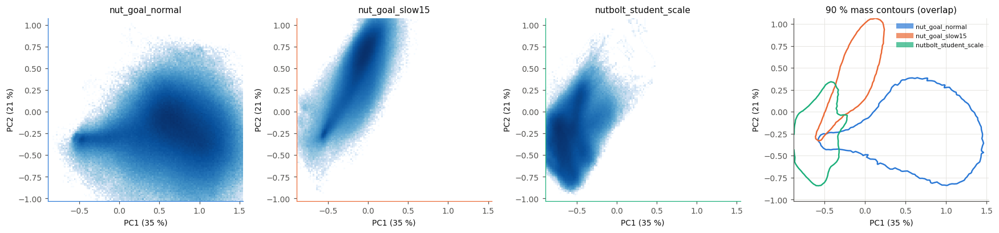

- 세 정책의 `joint_pos`를 같은 수만큼 모아 PCA를 fit했다. PC1과 PC2가 분산의 35%, 21%를 설명한다.
- 세 정책은 관절 공간에서 거의 겹치지 않는다. PC1–PC2 히스토그램 교집합은 normal–slow 0.02, normal–dexscrew 0.04, slow–dexscrew 0.16이다. 겹치는 곳은 ring/pinky를 펴는 slow와 dexscrew 사이에 조금 있을 뿐이다.
- 같은 task의 normal과 slow도 손 자세가 서로 다르다. 그래서 세 원천을 합치면 어느 하나만 쓸 때보다 coverage가 넓어진다.

## 11. 과제 진행

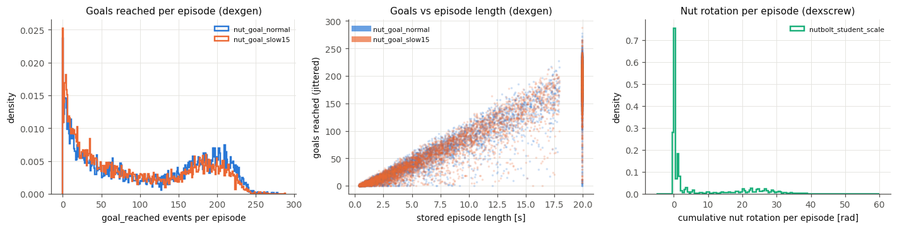

- **dexgen:** `goal_reached_event`는 목표(18° 회전)에 닿을 때마다 1번 켜지고, 그때 다음 목표가 생긴다. episode당 평균 106회(normal), 92회(slow)이고, 분당 545회, 529회다. 목표 수는 episode 길이에 거의 비례한다. 20 s timeout episode는 150–250회다.
- **dexscrew:** episode당 누적 넛 회전은 중앙값 0.27 rad, 평균 6.4 rad, p95 29 rad다. 대부분을 차지하는 짧은 stagnation episode는 거의 돌리지 못했다. 800 step timeout episode는 대략 15–35 rad를 돌렸다.
- **주의:** dexscrew의 모든 episode에서 마지막 저장 행의 `object_dof_pos`가 0이다 (reset 뒤의 값으로 보인다). 같은 행의 손 관련 필드는 정상이다. 누적 회전은 끝에서 두 번째 행으로 계산했다. 이 데이터로 학습할 때 마지막 행의 `object_dof_pos`는 쓰지 않는 것이 좋다.
